<p align="center">
  
</p>

<h1 align="center">PicGen</h1>

<p align="center">
  Windows 桌面悬浮窗 AI 生图工具 · 多供应商自动切换 · 图片工作台 · 历史资产库
</p>

<p align="center">
  <a href="https://github.com/GEEK-981/PicGen-Desktop/releases/latest"><b>下载最新版 2.3.20</b></a>
  ·
  <a href="#使用说明">使用说明</a>
  ·
  <a href="#常见问题">常见问题</a>
  ·
  <a href="#开发与构建">开发与构建</a>
</p>

---

PicGen 是一个常驻桌面的生图小窗：平时缩成屏幕边上的一个小图标，用的时候点开就能写提示词、拖参考图、出图。它可以接入 OpenAI（GPT Image）、Google Gemini（Nano Banana）、xAI Grok、豆包 Seedream 以及各种兼容这些接口的中转站。配好多个供应商以后，某一家报错或者排队，任务会自动换到下一家。

- **悬浮小窗**：拖到屏幕边缘就停靠成一条小标签，鼠标移过去展开，不占地方。
- **多序列并行**：开几个序列（标签页）同时跑不同的任务，每个序列有自己的提示词、模型和参考图。
- **多供应商自动切换**：按优先级、负载、价格或速度给任务分配供应商，出错自动重试其他家。
- **图片工作台**：在图上画框标注要改的地方、摆放尺寸参照物、涂抹蒙版做局部修改。
- **历史资产库**：所有生成的图都带着提示词保存，可以搜索、筛选、查找相似图、拖进 PS / AI 直接用。
- **全部在本地**：配置、密钥、图片都存在你自己电脑上，软件不上传任何东西（只会请求你配置的接口）。

> 本说明里的截图来自一个演示环境，图片是程序画的示意图，供应商地址都是示例域名。

## 下载安装

1. 打开 [Releases 页面](https://github.com/GEEK-981/PicGen-Desktop/releases/latest)，下载 `PicGen-2.3.20-x64.exe`。
2. 这是**便携版**，不用安装，双击就能运行。系统要求 Windows 10 / 11 64 位。
3. 第一次运行会在 exe 旁边创建 `PicGenData` 文件夹，里面是你的供应商配置、历史图片和加密密钥用的环境。**换电脑或换位置时，把 exe 和 `PicGenData` 整个文件夹一起搬走**，配置和历史就都还在。
4. Windows 可能提示"已保护你的电脑"（因为没有代码签名），点"更多信息 → 仍要运行"即可。

## 使用说明

### 1. 第一次使用：添加供应商

<table>
<tr>
<td width="52%" valign="top">

点左下角的 **⚙ 设置**，进入「API 提供商」。

1. 点右上角 **＋** 新增供应商，填写：
   - **供应商名称**：随便起，方便自己认。
   - **官网**（可选）：卡片上会显示，点一下能打开。
   - **Base URL**：接口地址，例如 `https://api.openai.com` 或中转站给你的地址。
   - **图标**：可以从图标库选，也可以上传图片。
2. 在下面的**配置组**里填 API Key 和模型名。一个供应商可以有多个配置组（比如一个生图、一个对话）。
3. 顶部的卡片可以左右滑动或用滚轮切换供应商。卡片上的圆点是健康状态：🟢 全部可用、🟠 部分可用、🔴 全部失败。

</td>
<td width="48%" align="center">
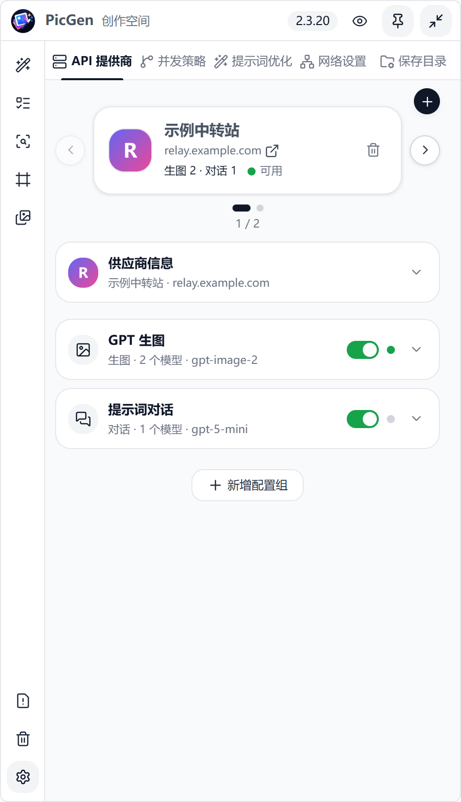
</td>
</tr>
<tr>
<td valign="top">

展开一个配置组可以编辑详细信息：

- **测试连接**：用当前填写的 Key 和模型试一次，不用先保存。
- **发现模型**：从接口拉取可用模型列表，一键添加。
- **模型列表**：每个模型一行，右边可以填**单张价格**（用于"价格优先"路由），左边是**请求格式**。一般保持自动即可；中转站特殊时可以手动指定 OpenAI Images / Gemini 原生 / Grok 等。
- **用途**：「生图」用于出图；「对话」用于提示词优化和反推。
- **最大并发 / 排序优先级**：这一组同时最多跑几个任务、在优先级路由里排第几。

> 模型名要和供应商文档里写的**完全一致**。PicGen 根据模型名判断走哪种协议，不看域名。

</td>
<td align="center">
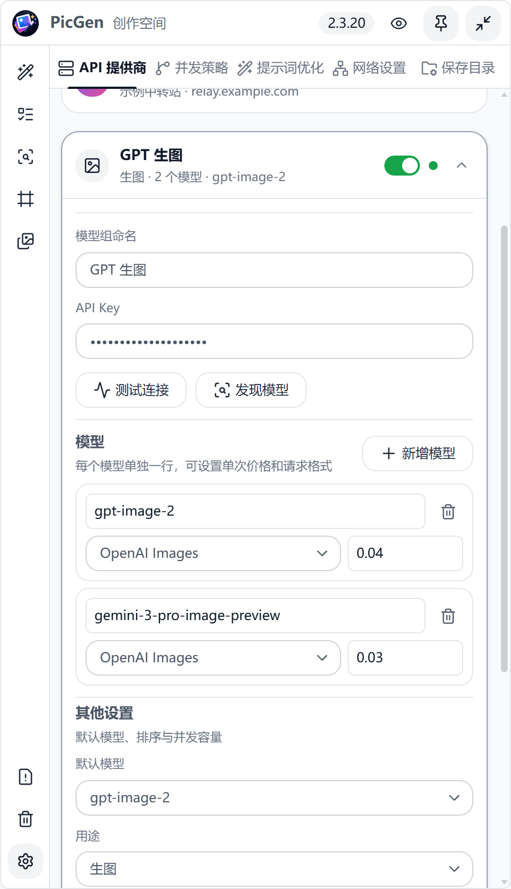
</td>
</tr>
</table>

### 2. 生成图片

<table>
<tr>
<td width="52%" valign="top">

点左侧第一个图标 **✨ 图片生成** 回到主界面。

1. 在**提示词**框里写描述。
2. **加参考图**：把图片拖到提示词框**底部那一条**（照片堆所在位置），或者点右下角的照片堆选择文件。
3. **在提示词里引用参考图**：输入 `@`，从弹出的列表里选一张，提示词里会出现带缩略图的标签，模型就知道"这张"指的是哪张。
4. 下方那一行显示当前的路由方式、模型、比例和张数，点 **高级** 可以调整模型、比例、分辨率、张数（最多 5 张）以及各家模型的专属参数。
5. 点 **生成**。进度条显示正在跑的任务数，**停止** 可以取消当前序列的任务。

**小技巧**
- 把一张 PicGen 生成的图拖到提示词框**上半部分**，会直接读出图里保存的提示词。
- 顶部的 **序列1 / 序列2** 是独立的工作区，点 **＋** 新开一个，可以同时跑不同的东西。
- 删除了被 `@` 引用的参考图后，提示词里会留下一个**空 @**，点它可以重新选图；空 @ 没处理之前不会提交。

</td>
<td width="48%" align="center">
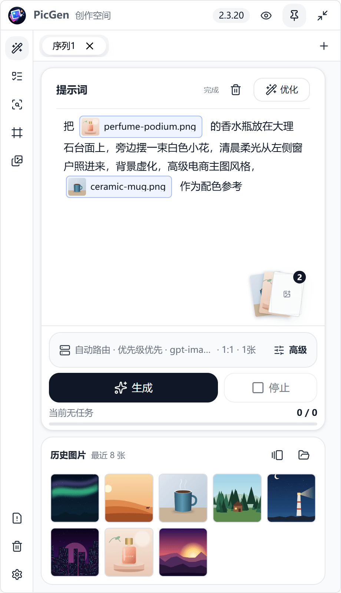
</td>
</tr>
<tr>
<td valign="top">

**提示词优化**

写了个大概的想法以后，点提示词右上角的 **优化**，会用你在「提示词优化」里设置的对话模型把它改写成更完整的生图提示词（主体、构图、光线、材质、风格）。结果会**流式**写回提示词框，随时可以点停止。

优化用的模型和系统提示词在 **设置 → 提示词优化** 里改。

</td>
<td align="center">
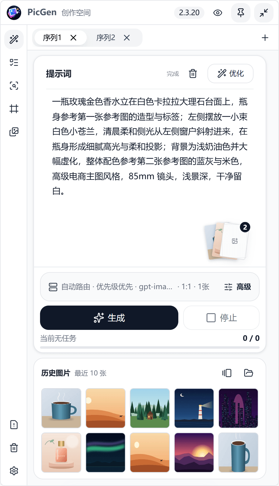
</td>
</tr>
</table>

### 3. 任务队列

<table>
<tr>
<td width="52%" valign="top">

左侧第二个图标 **☰ 队列管理** 显示所有序列的任务。

- 顶部统计**运行中**和**等待中**的数量。
- 每一行显示所属序列、模型、提示词、正在用哪个供应商，以及当前阶段（排队、选择线路、提交请求、下载、保存）。
- 单个任务点右边的 **×** 取消，**全部取消** 一次清空。

任务多的时候，PicGen 会在各个序列之间轮流调度：每个序列默认最多同时 3 个，全局最多 12 个，供应商满了的任务会在这里排队，而不是直接报错。

> 如果某个结果"不确定是否已经生成"（比如下载失败），PicGen 不会自动重新提交，避免重复扣费。

</td>
<td width="48%" align="center">
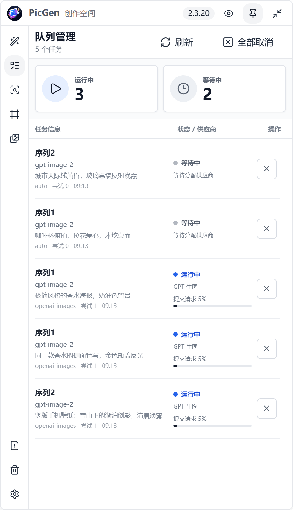
</td>
</tr>
</table>

### 4. 历史图片

<table>
<tr>
<td width="52%" valign="top">

左侧第五个图标 **🖼 历史图片** 是你的图片资产库。

- **搜索**：按提示词、文件名、模型搜索。支持多个词、`"引号整句"` 和 `-排除词`。右边的图片按钮可以**以图搜图**。
- **筛选**：按供应商、模型、比例、时间等条件过滤。
- **视图**：网格 / 列表 / **相似分组**（本地 AI 模型把看起来相似的图归成一组，方便挑选和清理，不上传任何图片）。
- 鼠标悬停显示大图预览（标题栏的 👁 可以关掉预览）。
- 图片可以**直接拖出窗口**，拖进 Photoshop、Illustrator、聊天软件或文件夹。
- 右键任意图片：发送到参考图、发送到图片工作台、复制图片、复制提示词、另存为、查找相似图片。

</td>
<td width="48%" align="center">
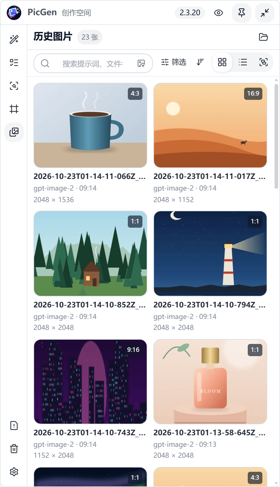
</td>
</tr>
<tr>
<td valign="top">

点一张图打开底部的**详情抽屉**：

- **详情**：文件名、模型、生成时间、尺寸、大小、使用记录（拖出 / 复制 / 另存过几次）。
- **提示词**：这张图当时用的完整提示词。
- **元数据**：图片里嵌入的原始信息。

底部按钮：**发送到参考图**、**另存为…**、**复制提示词**、**局部编辑**（直接进入工作台的蒙版模式）、**查找相似**、**移到回收站**。

删除的图片进入软件自己的**回收站**（左下角 🗑），可以还原；不会进 Windows 回收站。

</td>
<td align="center">
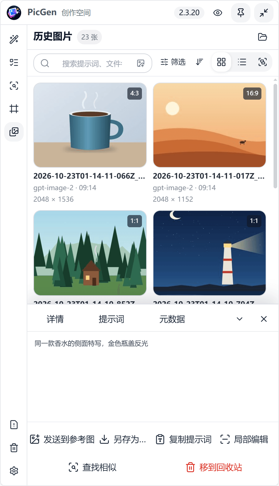
</td>
</tr>
</table>

### 5. 图片工作台

工作台把**标注、比例参考、局部编辑**三件事放在一个页面。入口：左侧 **# 图片工作台**、任意图片右键「发送到图片工作台」、或历史详情里的「局部编辑」。编辑完点 **发送到生成**，会自动加到当前序列的参考图并写好提示词。

<table>
<tr>
<td width="52%" valign="top">

**标注模式**：告诉模型"改哪里、怎么改"。

1. 选工具：框、圈、箭头、画笔、编号、文字。
2. 在图上圈出要改的地方，每一处会自动编号。
3. 在下面的**标注说明**里，给每个编号写修改要求，例如"瓶盖改成哑光黑色"。
4. 展开「将写入提示词」可以预览最终发给模型的文字。

画布操作：**滚轮缩放**，**按住中键拖动**（或空格 + 左键），**Ctrl+Z / Ctrl+Y** 撤销重做，**清空** 也可以撤销。

</td>
<td width="48%" align="center">
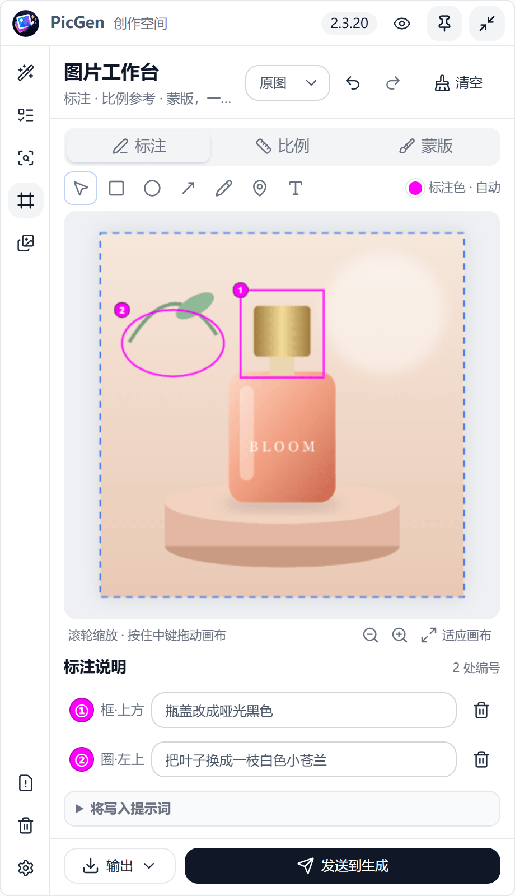
</td>
</tr>
<tr>
<td valign="top">

**比例模式**：让模型知道产品有多大。

从下面的**尺寸对比素材**里点一个（硬币、电池、易拉罐、长椅、门、轿车、铅笔……），它会按真实尺寸比例出现在产品旁边，可以拖动、缩放、旋转。

- **可出现在画面**：参照物会被画成真实物体，和产品同框。
- **仅作参照**：比如人、手，只用来告诉模型尺寸，不会画出来。

上方的**场景**可以写一句"放在浴室洗手台上"之类的描述。适合做电商场景图、尺寸示意图。

</td>
<td align="center">
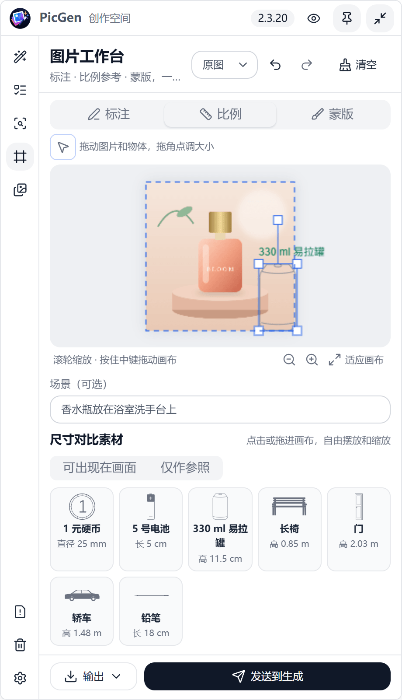
</td>
</tr>
<tr>
<td valign="top">

**蒙版模式**：只改涂抹的那一块。

1. 用**笔刷**涂要改的区域，**橡皮擦**修边，滑块调笔刷大小。
2. 在**修改要求**里写改成什么，例如"把杯身换成米白色哑光陶瓷"。
3. **生成模型**按种类选（Nano Banana / GPT / Grok / Seedream），PicGen 会自动选择合适的蒙版发送方式，不需要额外设置。
4. 非 GPT 模型可以打开**严格保持涂抹区外不变**：结果会贴回原图，涂抹区外一个像素都不动（边缘可能有接缝）。

**输出** 菜单可以把当前画布「输出到参考图」或「另存为」图片。

</td>
<td align="center">
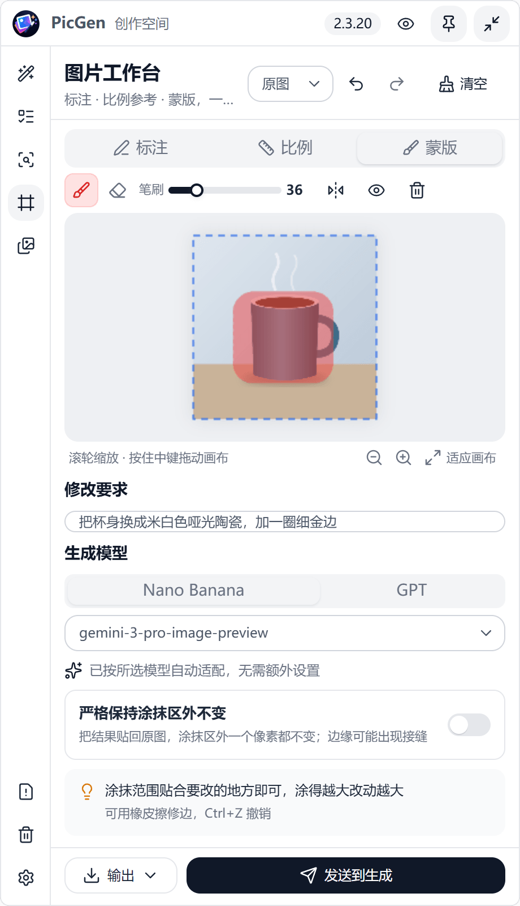
</td>
</tr>
</table>

### 6. 提示词反推

<table>
<tr>
<td width="52%" valign="top">

左侧第三个图标 **🔍 提示词反推**：看到一张喜欢的图，想知道怎么写提示词。

1. 把图片拖进来（或点击选择，也可以从历史图片右键发过来）。
2. **分析要求**可以改，比如"只描述光线和配色"。
3. 选择对话供应商和模型，点 **开始反推**，结果会流式显示。
4. **复制** 结果，或者点 **新建序列** 直接用这段提示词开一个新序列去生成。

反推用的是「对话」用途的配置组，需要支持图片输入的模型（例如 GPT-5、Gemini）。

</td>
<td width="48%" align="center">
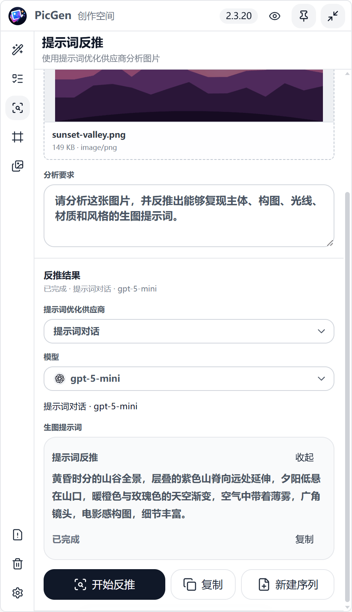
</td>
</tr>
</table>

### 7. 设置

<table>
<tr>
<td width="52%" valign="top">

**并发策略**：配置了多个供应商时，任务怎么分配。

| 策略 | 说明 |
|---|---|
| 优先级优先 | 优先级数字小的先用，满了顺延 |
| 按顺序使用 | 按列表顺序，满了顺延 |
| 负载均衡 | 选最空闲的，同样空闲时看优先级 |
| 指定提供商 | 固定一个，满了就排队，不切换 |
| 价格优先 | 用单张价格最低的（价格在模型行里填） |
| 速度优先 | 用本次运行里实测最快的 |

下面可以设置**全局最大并发**、每个配置组的并发容量，以及**失败处理**：开启后出错会自动换其他供应商重试，并可以设置最多尝试几次、连续失败几次后暂时冷却这个供应商。

</td>
<td width="48%" align="center">
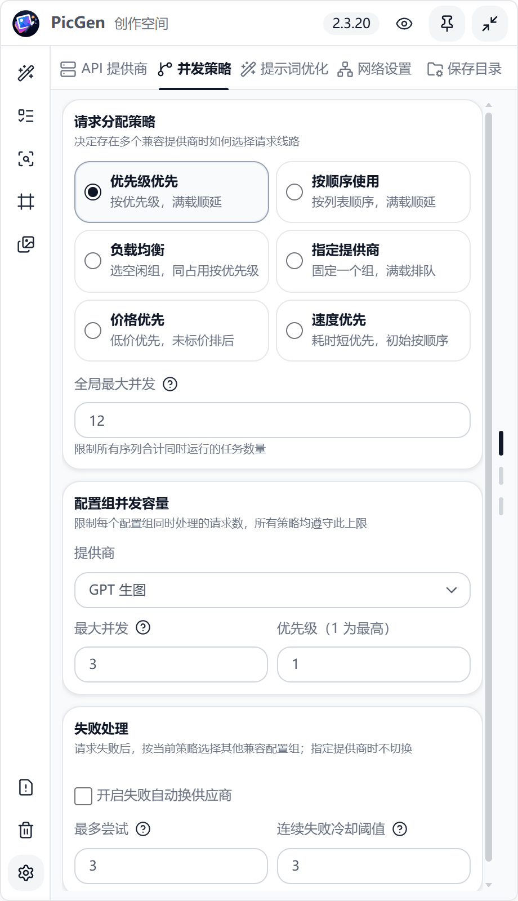
</td>
</tr>
<tr>
<td valign="top">

**提示词优化**：选择优化和反推用的对话模型，修改系统提示词（不满意可以恢复默认）。

</td>
<td align="center">
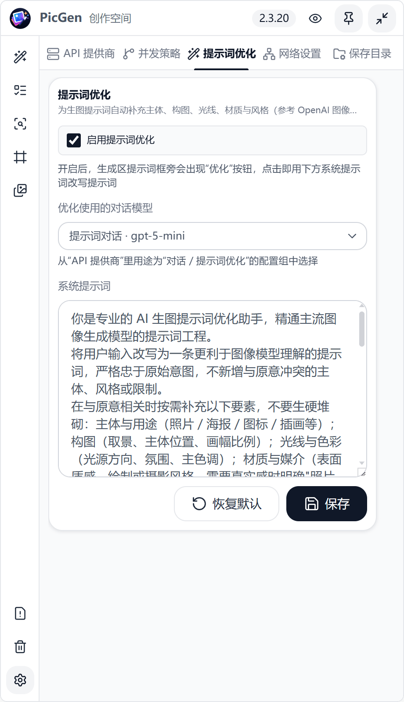
</td>
</tr>
<tr>
<td valign="top">

**网络设置**：

- **直连**：不走代理，直接访问接口。
- **系统代理**：跟随 Windows 的代理设置。
- **自定义代理**：填写 HTTP 或 SOCKS 代理地址。

点 **测试连接** 检查当前方式能不能连上。代理设置对生图请求和软件内网页都生效。

</td>
<td align="center">
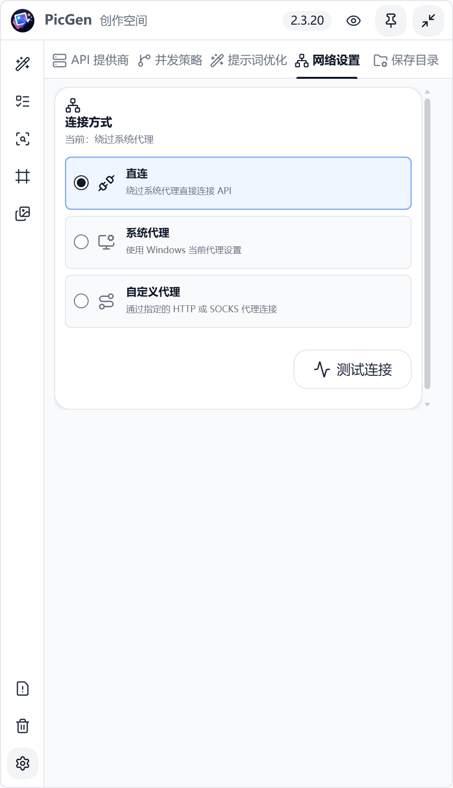
</td>
</tr>
<tr>
<td valign="top">

**保存目录**：生成的图片默认存在 `PicGenData\desktop-cache\images`，可以改到任意文件夹，例如网盘同步目录。

- **打开目录**：在资源管理器里打开。
- **恢复默认**：改回默认位置。

每张图都会把提示词、模型、比例等信息写进文件里（PNG / JPEG / WebP 都支持），之后拖回 PicGen 能直接读出来。

</td>
<td align="center">
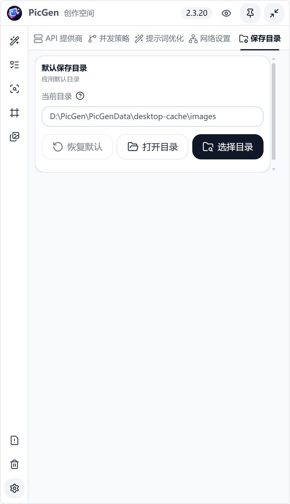
</td>
</tr>
</table>

### 8. 错误日志

<table>
<tr>
<td width="52%" valign="top">

左下角 **⚠ 错误日志** 汇总最近的错误。

- 每条错误都用**大白话**说明原因和建议，例如"供应商拒绝了访问 → 请检查 API Key 是否有效"。
- 点击展开可以看技术详情（状态码、原始返回），方便发给中转站客服。
- 可以按来源（图片生成、供应商、提示词优化、网络、存储……）和时间筛选，重复的错误会合并计数。
- 右侧按钮可以直接跳到对应的设置去修。

</td>
<td width="48%" align="center">
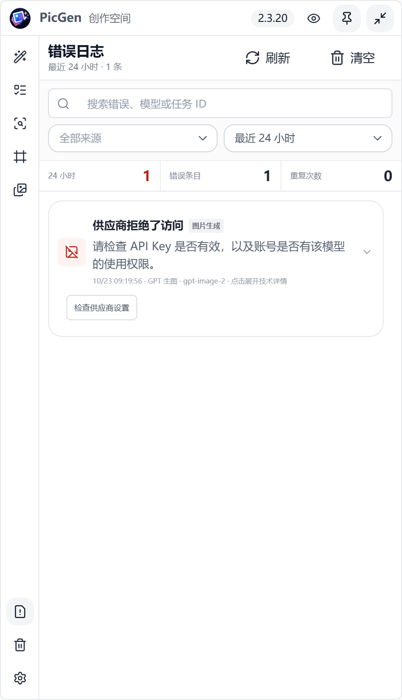
</td>
</tr>
</table>

### 9. 悬浮窗与停靠

- 标题栏右上角 **↙** 把窗口缩成一个小图标，点小图标再展开。托盘图标也能展开 / 收起。
- **拖动标题栏到屏幕左右边缘**（16 像素以内）就会停靠：离开 0.7 秒后缩成一条 12 像素宽的小标签，鼠标移上去或点击就展开。
- 标题栏的 **📌** 固定窗口，暂停自动隐藏；正在输入、打开菜单时也不会自动隐藏。
- 把标题栏从边缘拖开即可取消停靠。

## 常见问题

**生成失败，提示"供应商拒绝了访问"？**
检查 API Key 是否正确、账号有没有这个模型的权限。打开「错误日志」看技术详情里的原始返回。

**模型名填了，但提示不支持参考图 / 比例不对？**
PicGen 按模型名判断协议和能力。请确认模型名和供应商文档完全一致；中转站有特殊格式时，在配置组的模型行里手动选择「请求格式」。

**生成成功了但图片下载失败？**
有些网络环境会把图片服务器的域名解析到错误地址。2.3.20 起会自动改用公共 DNS 重试；仍失败时可以在「网络设置」里换代理。这类任务不会被自动重新提交，以免重复扣费。

**换电脑后历史和配置都没了？**
便携版的数据在 exe 旁边的 `PicGenData` 文件夹里，要整个文件夹一起复制（包括里面的 `Local State`，否则保存的 API Key 无法解密）。

**我的图片和 Key 会被上传吗？**
不会。PicGen 只请求你自己配置的接口地址；相似图分析用的是内置在软件里的本地模型。

## 2.3.20 更新内容

- **提示词拖放分区**：拖图到提示词区时，上半部分＝读取图片里的提示词，底部照片堆那一条＝添加为参考图，拖动时会高亮显示两个区域。非图片文件不会误触发。
- **空 @ 占位**：删除被引用的参考图后，提示词里的引用变成可点击的空 @，点它重新选图；有空 @ 时不会提交生成或优化。
- **复制 / 剪切只写纯文本**：从提示词框复制带参考图标签的内容，不再把几 MB 的图片数据带进剪贴板（之前粘贴到 Obsidian 等软件会卡死）。
- **提示词优化 / 反推**：超时放宽到 3 分钟；点「停止」立即结束，不再卡在停止状态。
- **结果图下载更稳**：本地 DNS 被污染（证书错误、连接被拒）时，自动改用公共 DNS 解析的地址重试，不关闭证书校验。

完整历史见 [Releases](https://github.com/GEEK-981/PicGen-Desktop/releases)。

## 开发与构建

```bash
npm install                 # 安装依赖
npm start                   # 开发模式运行（会先构建前端）
npm test                    # 单元测试
npm run build:win:portable  # 打包便携版 → dist/release/PicGen-<版本>-x64.exe
```

- 技术栈：Electron 42 + React 19 + Appica UI（MIT）+ Tailwind CSS 4 + Vite。
- 本地 API 服务（Express + WebSocket）只绑定 `127.0.0.1`，由 Electron 主进程启动，没有单独的网页端。
- 协议由**模型名**推断（`gemini-native`、`openai-images`、`xai-imagine`、`grsai-nano-banana`、`openai-chat`），不看供应商域名。
- 冒烟测试：`node scripts/packaged-smoke.js "<exe 路径>" <版本>`（使用临时隔离配置和本地 mock 接口）。
- 架构细节见 [CLAUDE.md](CLAUDE.md)。

## 许可证

[MIT](LICENSE)。第三方组件的许可证见 [licenses/](licenses/)。
